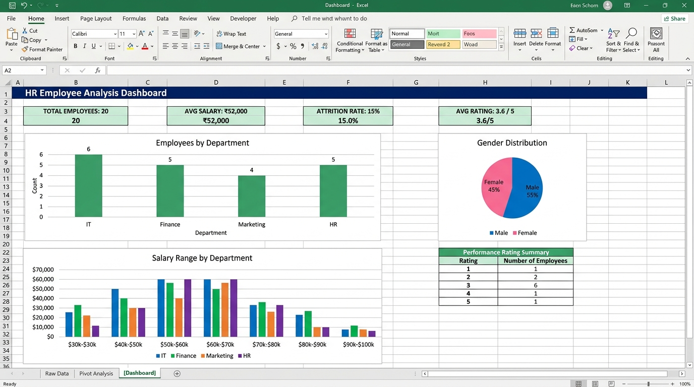

# HR Employee Analysis - Excel

An HR data analysis project created in Microsoft Excel to understand workforce trends, salary distribution, attrition patterns, and performance ratings.

## Dashboard Preview



## About the Project

This was a practice project where I analyzed a sample HR dataset of 20 employees using Excel features like Pivot Tables, charts, and basic formulas. The goal was to derive useful insights that an HR team might need.

## Tools and Features Used

- Microsoft Excel (2019 / Office 365)
- Pivot Tables
- Charts (Bar, Pie, Line)
- Conditional Formatting
- COUNTIF, AVERAGEIF, IF formulas

## What the Analysis Covers

- Department-wise headcount
- Gender distribution
- Salary range and averages
- Attrition rate (who left the company)
- Performance rating summary

## Project Structure

```
HR-Employee-Analysis-Excel/
|-- data/
|   |-- employee_data.csv
|-- screenshots/
|   |-- dashboard_preview.jpg
|-- README.md
```

## Dataset

The employee_data.csv file has 20 employee records with columns: Emp_ID, Name, Department, Gender, Age, Salary, Join_Date, Performance_Rating, Attrition, Leaves_Taken.

## How to Use

1. Download the repository
2. Open employee_data.csv in Excel
3. Use Insert > Pivot Table to start analyzing
4. Apply charts on top of the pivot tables for visuals